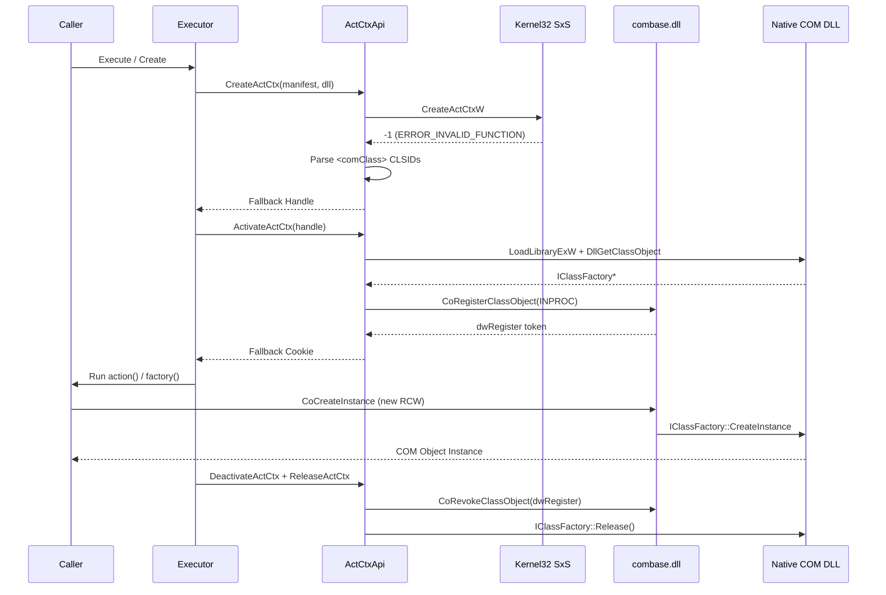

# ADR-0023: Fall Back to Manifest-Driven In-Process Class Registration on Windows Nano Server

- Status: Accepted
- Date: 2026-10-25
- Deciders: @AdaskoTheBeAsT
- Release: v4.1.0
- Extends [ADR-0002](0002-registration-free-com-via-activation-contexts.md), [ADR-0005](0005-internal-native-methods-wrapper.md), and [ADR-0019](0019-safe-activation-context-cleanup.md)

## Context

When running registration-free COM workloads inside Windows Nano Server 2025 (`ltsc2025`) containers (both x64 and WOW64 x86), three OS-level constraints surface:

1. **Win32 Side-by-Side (`CreateActCtxW`) is unmapped in Nano Server's API-set schema:**
   - Although `KernelBase.dll` and `combase.dll` are present, `KernelBase!CreateActCtxW` first invokes `IsCreateActCtxWWorkerPresent()`, which queries `PEB->ApiSetMap` for `ext-ms-win-kernel32-sidebyside-l1-1-0.dll`.
   - In Nano Server's kernel-mapped `C:\Windows\System32\apisetschema.dll`, `ext-ms-win-kernel32-sidebyside-l1-1-0` has zero host targets because the CSRSS side-by-side subsystem (`sxssrv.dll` and `sxs.dll`) is omitted from Nano Server. Consequently, `CreateActCtxW` immediately returns `INVALID_HANDLE_VALUE` (`-1`) with `ERROR_INVALID_FUNCTION` (`1`).
   - Replacing `apisetschema.dll` with Server Core's copy is not viable: Server Core's schema redirects console and windowing API sets away from Nano Server's headless `coniosrv.dll`, causing container silo startup to fail with `0xc0370111`.
2. **Headless COM apartment and message-queue constraints:**
   - `combase!CoInitializeEx(NULL, COINIT_APARTMENTTHREADED)` (`STA`) returns `E_NOTIMPL` (`0x80004001`) on Nano Server because single-threaded apartments create a hidden Win32 message window (`OleMainThreadWndClass`) requiring the `win32u.dll` kernel GDI/User subsystem, which Nano Server does not include.
   - `combase!CoInitializeEx(NULL, COINIT_MULTITHREADED)` (`MTA`) succeeds (`S_OK`).
   - `user32.dll` is absent from `C:\Windows\System32` on Nano Server (only a minimal forwarder stub exists under `System32\forwarders`), so P/Invoking `user32.dll!PeekMessageW` during default post-callback message pumping throws `DllNotFoundException` or `EntryPointNotFoundException`.
3. **`combase.dll` retains its full in-process class table:**
   - Even without SxS or registry entries under `HKCR\CLSID`, `combase.dll` on Nano Server exports `CoRegisterClassObject`, `CoRevokeClassObject`, and `CoCreateInstance`.
   - When an in-process COM DLL's `IClassFactory` (obtained via its exported `DllGetClassObject`) is registered in the current process with `CoRegisterClassObject(ref clsid, pFactory, CLSCTX_INPROC_SERVER, REGCLS_MULTIPLEUSE, out uint token)`, subsequent `CoCreateInstance` calls (including standard .NET RCW instantiation such as `new NativeCOM.StringConcatenatorClass()`) resolve the class factory directly from `combase.dll`'s in-process class table before consulting SxS activation contexts or the registry.

## Decision

- Keep Win32 SxS activation contexts (`CreateActCtxW`, `ActivateActCtx`, `DeactivateActCtx`, `GetCurrentActCtx`, `ReleaseActCtx`) as the primary activation mechanism whenever supported by the OS.
- When `CreateActCtxW` returns `INVALID_HANDLE_VALUE` (`-1`) with `ERROR_INVALID_FUNCTION` (`1`), `ERROR_NOT_SUPPORTED` (`50`), or `ERROR_CALL_NOT_IMPLEMENTED` (`120`), transparently fall back inside `ActivationContextApi` to a manifest-driven in-process class registration context:
  1. Parse `<comClass clsid="..."/>` elements (and any `<dependentAssembly>` manifests in the assembly directory) from the `.manifest` file using `XmlReader` configured with `DtdProcessing.Prohibit` and `XmlResolver = null`. Missing or malformed manifests fail with `Win32Exception`, matching SxS error semantics.
  2. When activating a fallback context (`ActivateActCtx`), load the target COM DLL via `LoadLibraryExW`, resolve `DllGetClassObject`, request `IID_IClassFactory` (falling back to `IID_IUnknown`), and register each class factory via `combase!CoRegisterClassObject` with `CLSCTX_INPROC_SERVER` (`0x1`) and `REGCLS_MULTIPLEUSE` (`0x1`). If the calling thread has not yet initialized COM (`CO_E_NOTINITIALIZED`), initialize `COINIT_MULTITHREADED` (`MTA`) and retry registration.
  3. Cache loaded native module handles (`HMODULE`) by normalized full path for the lifetime of the process rather than calling `FreeLibrary` immediately on context teardown. This matches `combase.dll`'s module caching and prevents `0xC0000005` access violations if a caller creates local RCWs inside `Execute` that are finalized later by the garbage collector.
  4. Track fallback handles and cookies with the exact same reference-counting, thread-ownership, and LIFO stack invariants enforced by `Executor` and `ComObjectHandle<T>`.
  5. When deactivating a fallback context (`DeactivateActCtx`), revoke registered class factories in reverse order via `CoRevokeClassObject` and release their `IClassFactory` pointers via `Marshal.Release`. Retain any unrevoked entries if a native call fails so `Executor.Free` retries remain deterministic.
- Guard `NativeMethods.PumpPendingMessages()` against `DllNotFoundException` and `EntryPointNotFoundException` when `user32.dll!PeekMessageW` is absent on headless Windows Nano Server, treating the pump as a safe no-op.

## Consequences

- Positive: `Executor.Execute`, `Executor.Create`, `Executor.Free`, `ComExecutor`, and `ComObjectHandle<T>` work out-of-the-box on Windows Nano Server 2025 (both x86 and x64) using standard `new MyComClass()` RCW instantiation and existing `.manifest` files.
- Positive: Standard Windows Desktop and Windows Server Core deployments continue to use kernel SxS activation contexts with zero behavior change or overhead.
- Positive: All existing LIFO cookie ordering, thread-affinity checks, retry semantics, and `ActivationContextApi` unit-test hooks remain intact.
- Negative: On Windows Nano Server, callers must run on an `MTA` thread (avoiding `[STAThread]` / `ApartmentState.STA`, which returns `E_NOTIMPL` from `combase.dll`), and `CoRegisterClassObject` registrations are process-wide for the duration of the active context rather than per-thread like SxS activation stacks.

## Alternatives Considered

- Requiring callers to invoke `DllGetClassObject` manually on Nano Server: rejected because it breaks standard `new MyComClass()` RCW instantiation and forces application code to diverge between Server Core and Nano Server.
- Copying `sxs.dll`, `sxssrv.dll`, and `apisetschema.dll` from Server Core into Nano Server images: rejected because Server Core's `apisetschema.dll` is incompatible with Nano Server's headless console/windowing subsystem and prevents container boot (`0xc0370111`).
- Calling `FreeLibrary` on every `ReleaseActCtx` in fallback mode: rejected because uncollected RCWs created inside `Execute` callbacks would crash the process with an access violation when finalized by the GC after the DLL is unmapped.

## References

- `src/AdaskoTheBeAsT.Interop.COM/ActivationContextApi.cs`
- `src/AdaskoTheBeAsT.Interop.COM/Executor.cs`
- `src/AdaskoTheBeAsT.Interop.COM/NativeMethods.cs`
- `test/unit/AdaskoTheBeAsT.Interop.COM.Test/NanoServerFallbackTest.cs`
