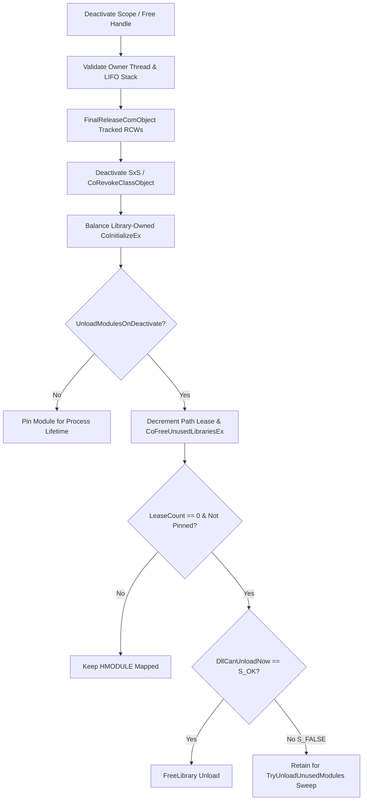

# ADR-0027: Reference-Counted Native Module Leases, `DllCanUnloadNow` Unload Safety, and Apartment-Aware Fallback Initialization

- Status: Accepted
- Date: 2026-11-15
- Deciders: @AdaskoTheBeAsT
- Release: v5.0.0
- Extends [ADR-0019](0019-safe-activation-context-cleanup.md), [ADR-0023](0023-nanoserver-inproc-class-factory-fallback.md), and [ADR-0024](0024-nanoserver-sta-shim-and-options.md)

## Context

Two lifecycle limitations surfaced when scaling isolated COM worker pools across Desktop Windows and Windows Nano Server:

1. **Process-lifetime `HMODULE` retention blocks worker recycling and directory cleanup:**
   - Legacy VB6 and C++/Delphi COM servers frequently store mutable global state in `.data`/`.bss` sections, requiring hosts to copy the server DLL into per-worker directories (`worker_01\server.dll`) and recycle those copies between sessions.
   - Unconditional process-lifetime caching (`_loadedModules` in v4.1–v4.2) keeps `server.dll` mapped forever, preventing `.data`/`.bss` reset and blocking temp-directory deletion. Conversely, calling `FreeLibrary` blindly when one scope ends crashes the process if an overlapping scope shares the same DLL path or if `DllCanUnloadNow()` still reports live native objects (`S_FALSE`).
   - Additionally, loading COM DLLs that depend on sibling helper DLLs in the worker folder benefits from `LOAD_LIBRARY_SEARCH_DLL_LOAD_DIR | LOAD_LIBRARY_SEARCH_DEFAULT_DIRS` (`0x00001100`) before falling back to `LOAD_WITH_ALTERED_SEARCH_PATH` (`0x00000008`).
2. **Unconditional `MTA` auto-initialization on Nano Server fallback:**
   - In v4.1–v4.2, when `CoRegisterClassObject` returned `CO_E_NOTINITIALIZED`, fallback unconditionally called `CoInitializeEx(IntPtr.Zero, COINIT_MULTITHREADED)` even when the manifest declared `threadingModel="Apartment"` or `"Single"`.
   - At the same time, COM forbids silently converting an already-initialized `MTA` thread into `STA` (`RPC_E_CHANGED_MODE = 0x80010106`), and `CoUninitialize` must only be called for initialization frames actually acquired by this library on the same thread.

## Decision

1. **Keep process-lifetime retention as the safe default (`UnloadModulesOnDeactivate = false`), and support opt-in reference-counted module leases (`LoadedModuleEntry` / `ModuleLease`):**
   - Probe native COM DLLs with `LoadLibraryExW(path, 0, 0x00001100)`, falling back on `ERROR_INVALID_PARAMETER` (`87`) to `LOAD_WITH_ALTERED_SEARCH_PATH` (`0x00000008`) and `LoadLibraryW`.
   - Track per-normalized-path `LeaseCount`, `PinnedForProcessLifetime` (sticky once any non-unloading scope touches the path), and `UnloadEligibleWhenIdle`.
   - When `UnloadModulesOnDeactivate = true`, release all tracked RCWs first, deactivate SxS contexts / revoke fallback class factories, invoke `combase!CoFreeUnusedLibrariesEx(0, 0)`, and call `FreeLibrary` only when `LeaseCount == 0`, `!PinnedForProcessLifetime`, and `DllCanUnloadNow()` (when exported) returns `S_OK` (`0`).
   - If `DllCanUnloadNow()` returns `S_FALSE` (e.g., an untracked RCW is still alive), retain the module entry as `UnloadEligibleWhenIdle = true` and expose `Executor.TryUnloadUnusedModules()` so callers can deterministically sweep freed modules once remaining references are released.
2. **Make Nano Server fallback apartment initialization manifest- and option-aware:**
   - Support `ComActivationOptions.ApartmentState` (`Unknown`, `STA`, `MTA`).
   - Probe current thread apartment state without leaking initialization references; if the thread already initialized COM in an incompatible apartment relative to an explicit `ComActivationOptions.ApartmentState`, fail with `RPC_E_CHANGED_MODE` (`0x80010106`) rather than silently mutating apartment state.
   - On uninitialized threads (`CO_E_NOTINITIALIZED`), initialize `COINIT_APARTMENTTHREADED` when `ApartmentState.STA` is requested or when `ApartmentState.Unknown` and the parsed manifest requires `STA` (`Apartment` or `Single`); otherwise initialize `COINIT_MULTITHREADED`. Balance only library-acquired initialization frames via `CoUninitialize` during owner-thread teardown.

## Consequences

- Positive: Isolated worker directories can load, execute, unload (`GetModuleHandleW == 0`), and delete their DLLs synchronously on deactivation without risking premature `FreeLibrary` across overlapping scopes or live native objects.
- Positive: `Apartment`/`Single` COM components auto-initialize `STA` on uninitialized Nano Server fallback threads while respecting pre-existing caller apartments and propagating `RPC_E_CHANGED_MODE` accurately.
- Negative: On Desktop Windows where `combase.dll` loads DLLs internally during `CoCreateInstance`, callers opting into deterministic unloading should pair `UnloadModulesOnDeactivate = true` with `PreloadModules = true` and register created RCWs via `scope.TrackObject(...)` (or use `Create`).

## Alternatives Considered

- Unloading modules unconditionally on `Deactivate` ignoring `DllCanUnloadNow`: rejected because any surviving native interface pointer or background callback into an unmapped DLL causes an immediate `0xC0000005` access violation.
- Silently calling `CoUninitialize` on a caller-owned `MTA` thread to re-initialize as `STA`: rejected because mutating a thread's COM apartment underneath caller-owned COM state corrupts active proxies and violates COM threading rules.

## References

- `src/AdaskoTheBeAsT.Interop.COM/ActivationContextApi.cs`
- `src/AdaskoTheBeAsT.Interop.COM/Executor.cs`
- `src/AdaskoTheBeAsT.Interop.COM/ComActivationOptions.cs`
- `test/unit/AdaskoTheBeAsT.Interop.COM.Test/ComActivationScopeAndModuleLeaseTest.cs`
